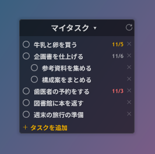

# Tasks Sync for Rainmeter

Google Tasks をデスクトップで**双方向**に扱える Rainmeter スキン。
A Rainmeter skin for **two-way** Google Tasks on your Windows desktop.

 

## インストール / Install

1. [Releases](https://github.com/atsushi4649/tasks-sync-rainmeter/releases) から `TasksSync_x.y.z.rmskin` をダウンロードしてダブルクリック
   Download the `.rmskin` from Releases and double-click it.
2. **[セットアップ手順 / Setup guide](https://atsushi4649.github.io/tasks-sync-rainmeter/setup.html)** に沿って、自分用の Google OAuth クライアントを作る（約 10 分・最初の 1 回だけ）
   Create your own Google OAuth client (~10 min, once).

必要なもの / Requirements: Rainmeter 4.4+, Windows 10/11 (PowerShell 5.1 は標準搭載 / built in)

## 制限 / Limitations

- 日付は Google Tasks の「日時」（カレンダーのアイコン）を表示します。「期限」（的のアイコン）は Google Tasks API から取得できないため表示されません。
  Shows a task's *date* (calendar icon). The newer *deadline* (target icon) isn't exposed by the Google Tasks API.
- 時刻は表示されません（API が日付しか返さないため）。 / Times aren't shown (the API returns dates only).

## 設定 / Settings

スキンを右クリック →「設定を編集」で `Variables.inc` が開きます（言語・幅・表示件数・同期間隔・色）。
Right-click → *Edit settings* (`Variables.inc`): `Language=en` for English, width, max tasks, sync interval, colors.
Windows 10: `IconFont=Segoe MDL2 Assets`

## プライバシー / Privacy

- データはあなたの PC と Google の間だけでやり取りされます。作者のサーバーはありません。
  Data only travels between your PC and Google. There is no author server.
- ログイン情報・client_secret・タスクのキャッシュは `%APPDATA%\Rainmeter\TasksSync` に保存されます（スキンのフォルダには入りません）。リフレッシュトークンは Windows DPAPI で暗号化されます。
  Token, client_secret and task cache live in `%APPDATA%\Rainmeter\TasksSync` (never in the skin folder); the refresh token is DPAPI-encrypted.
- [プライバシーポリシー / Privacy Policy](https://atsushi4649.github.io/tasks-sync-rainmeter/privacy.html)

## 仕組み / How it works

Rainmeter の WebParser は POST / PATCH / DELETE や OAuth を扱えないため、通信は同梱の PowerShell スクリプト（`@Resources\Scripts\GTasks.ps1`）が担当し、RunCommand プラグイン経由で呼び出します。スクリプトが表示用の `.inc` を生成してスキンを更新します。
Rainmeter's WebParser can't do POST/PATCH/DELETE or OAuth, so a bundled PowerShell script handles the API via the RunCommand plugin and regenerates the skin's `.inc` files.

## License

MIT
